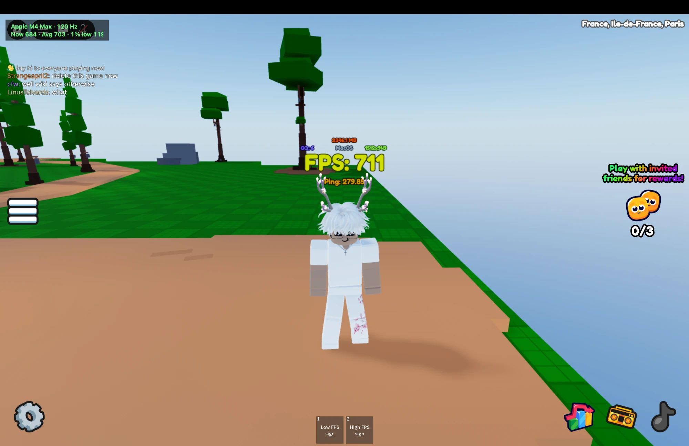

# robloxMacOSuncap

**Uncapped** for Roblox on macOS.

Run Roblox on macOS past your display's refresh rate and past Roblox's 240 fps cap, with an on-screen counter that shows the real render rate.

On an M4 Max at low graphics, this goes from 120 fps to around 700 to heavier games at 400 constant. 



> [!WARNING]
> This injects a library into the Roblox client, which is against Roblox's Terms of Use. It doesn't touch gameplay, but use it at your own risk and preferably not on an account you can't afford to lose. You also have to log in again on the first launch.

## Install

Paste this into Terminal (Applications → Utilities → Terminal):

```
curl -fsSL https://raw.githubusercontent.com/Pogo-Bash/robloxMacOSuncap/main/install.sh | bash
```

It downloads the latest build from [Releases](https://github.com/Pogo-Bash/robloxMacOSuncap/releases), installs **Uncapped** to your Applications folder and opens it. After that, open Uncapped from Launchpad or Spotlight instead of Roblox. No Terminal needed again.

To launch it from Terminal instead:

```
open -a Uncapped
```

To uninstall and put Roblox back to normal:

```
curl -fsSL https://raw.githubusercontent.com/Pogo-Bash/robloxMacOSuncap/main/install.sh | bash -s -- --uninstall
```

### From source

```
git clone https://github.com/Pogo-Bash/robloxMacOSuncap.git
cd robloxMacOSuncap
./uncapped.sh
```
It builds the library on first run, and offers to install Apple's command line tools if they're missing.

The overlay shows your chip and refresh rate, then **Now** (frames finished in the last half second), **Avg** (the average over the last ~8,000 frames with the fastest and slowest 5% dropped, a steady number to compare Macs with) and **1% low** (the frame rate of the slowest 1% of frames, which is where stutter shows). The screen can't show more frames than its refresh rate; the extra frames reduce input latency.

## How it works

macOS caps Roblox in two places.

**1. The display link (the 120 Hz cap).** Roblox paces rendering with a display link from `-[NSView displayLinkWithTarget:selector:]`, which fires once per screen refresh. Disabling vsync alone does nothing, because Roblox never asks for a second frame. `uncapped.dylib` catches that display link and also fires Roblox's callback from its own high-rate timer. It passes a proxy link whose timestamps match the timer, reports the screen as faster than it is, and forces `CAMetalLayer.displaySyncEnabled = NO`.

**2. Roblox's frame cap (240).** This is the `FramerateCap` value in `~/Library/Roblox/GlobalBasicSettings_13.xml`. The launcher raises it, and keeps a backup next to the file.

To load the library, the launcher copies `Roblox.app` to `~/Library/Application Support/uncapped/`, ad-hoc re-signs the copy (which drops the hardened runtime), and starts it with `DYLD_INSERT_LIBRARIES`. It only re-copies when Roblox updates.

The display-link and vsync parts are generic, so they may help other Metal games capped at the refresh rate. Contributions for other games are welcome.

## Releases

Pushing a `v*` tag runs the GitHub Actions workflow in `.github/workflows/release.yml`, which builds `uncapped.dylib`, assembles `Uncapped.app` and attaches `Uncapped.zip` to the release that `install.sh` downloads.

## Caveats

- Roblox's physics steps at most 240 times a second. Above that, staff say values like `Heartbeat`'s delta time can be off. If a game feels wrong, try `UNCAPPED_FPS=240`.
- macOS 14 or newer.

## License

GPL-3.0. See [LICENSE](LICENSE).
